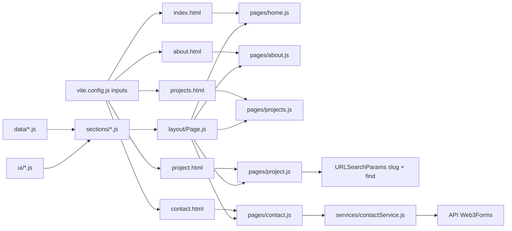

# Requirements

### Objectif

Construire le portfolio de Gabriel Nganty (Vite + Tailwind v4 + JavaScript vanilla modulaire) **fidèlement à la maquette Figma analysée**, découpé en tickets autonomes qu'on peut donner un par un à Codex.

> **Correction importante par rapport à la version précédente de ce plan.** Après analyse des 10 captures, la maquette n'est **pas** une page unique à ancres : c'est un **site à 4 pages** (Home, About, Projects, Contact) **plus une page de détail par projet**. Tout le découpage a été refait sur cette base.

### Pages et blocs relevés dans la maquette

| Page | Blocs |
|---|---|
| **Home** (`index.html`) | Hero (fond « Grillage bleu-blanc », sur-titre `HELLO, I'M GABRIEL NGANTY`, titre display avec « Gabriel » en bleu accent, sous-titre stack, bouton `Download CV ⤓`, icônes sociales, bouton `Selected Work ↓`) → section `/Selected Work` (bouton `View All Work ↗`, chips de filtre `All · Figma · GitHub`, grille 2 colonnes de 4 cartes) → bloc `How I like to work` (4 items icône + titre + description) → CTA de pied de page |
| **About** (`about.html`) | Sur-titre `A LITTLE ABOUT ME` + titre 2 lignes → photo + « Hi, I'm Gabriel. » + 2 paragraphes → `My everyday toolkit` (4 groupes : Backend, Database, DevOps, Frontend, en tags) → `How I like to work` (**le même bloc que Home**) → CTA |
| **Projects** (`projects.html`) | Sur-titre `DESIGN MEETS DEVELOPMENT` + titre `Projects & experiments.` + paragraphe → chips de filtre → grille des 4 projets (**la même grille que Home**) → CTA |
| **Détail projet** (`project.html?slug=…`) | Bouton `← All projects` → sur-titre catégorie en accent (`FIGMA MOCKUP · CONCEPTUAL PROJECT`) → titre → description → tags → visuel → méta 4 colonnes (`ROLE / YEAR / TYPE / STACK`) → boutons de liens (`Figma file ↗`, `Live demo ↗`, `GitHub repo ↗`) → `Under the hood` → `NEXT PROJECT →` + titre du suivant → CTA |
| **Contact** (`contact.html`) | Sur-titre `GET IN TOUCH` + `Let's start a conversation` + paragraphe → colonne gauche (`EMAIL`, `LOCATION` Douala Cameroon (ENSPD), `AVAILABILITY` • Open to internships & freelance) → colonne droite `Send a Message` (Name\*, Email\*, Subject, Message\*, bouton noir pleine largeur `Send message ↗`) → CTA |
| **Partagé partout** | Navbar (logo `NG.` + liens + **icône dark mode**), CTA `You made it! Curious to say hello? / Get in touch ↓` + `Email ↗ | LinkedIn ↗`, footer `Crafted & hand-coded by Gabriel Nganty · Douala, Cameroon · © 2026` + bouton rond retour en haut |

### Exigences fonctionnelles

1. Les liens de la navbar sont de **vraies navigations** entre fichiers HTML ; le lien de la page courante est souligné en accent (`aria-current="page"`).
2. En dessous de `md:`, le burger ouvre un **panneau plein écran** (logo + croix + liens empilés), fermé au clic sur un lien, au clic sur la croix et à la touche `Échap`.
3. L'icône de droite de la navbar est un **bouton dark mode non implémenté** (markup + `aria-label` seulement) et **remplace** le bouton pilule `Contact ↗` de la maquette — décision validée.
4. Les chips `All · Figma · GitHub` filtrent la grille **côté client**, sans rechargement, en mettant à jour l'état actif et en annonçant le nombre de résultats.
5. Chaque carte projet mène à `project.html?slug=<id>` ; la page de détail lit le `slug` et affiche le projet correspondant, ainsi que le projet suivant dans `NEXT PROJECT`.
6. Ajouter un projet, un groupe du toolkit ou un principe de travail = **modifier uniquement un fichier de `src/data/`**, jamais de HTML.
7. Le formulaire de contact gère quatre états visibles : `idle → loading → success | error`, avec validation côté client avant envoi (requis, format email, longueur minimale du message) ; les erreurs s'affichent sous le champ et sont reliées via `aria-describedby`.
8. Mobile-first : le design fonctionne à partir de 320px de large, conformément aux variantes mobiles de la maquette.

### Exigences non fonctionnelles

- **Accessibilité** : balises sémantiques (`header`, `nav`, `main`, `section`, `footer`), `label` liés aux inputs, `alt` sur les images, focus visible, contraste suffisant.
- **Performance** : images en WebP avec `loading="lazy"` et dimensions explicites ; aucune dépendance runtime lourde.
- **SEO / partage** : chaque page a son propre `title`, sa `description` et ses balises Open Graph.
- **Pas de clé secrète dans le front** : seule la clé *publique* Web3Forms est présente, injectée via une variable `VITE_*`.

### Hors périmètre (volontairement)

- L'implémentation réelle du dark mode (seulement le bouton).
- Le bouton pilule `Contact ↗` de la navbar (remplacé par l'icône).
- Le multilingue, un CMS, un back-office.
- Des tests unitaires automatisés (aucun runner installé) — la validation se fait via build + vérification navigateur.

# Technical Design

### État actuel

- `index.html` : squelette minimal, `<div id="app">` + `<script type="module" src="/src/main.js">`.
- `src/main.js` : injecte directement une page de démonstration dans `#app` via `innerHTML`.
- `src/assets/hero.png` existe ; le fond « Grillage bleu-blanc » et le logo `NG.` (cercle 48×48, contour `color/ink`, wordmark `NG.`) seront exportés en SVG depuis Figma.
- `src/style.css` : **le design system est déjà posé** — tokens couleurs (`--color-ink`, `--color-muted`, `--color-accent: #2f5bff`, `--color-background`, `--color-border`, `--color-surface`, `--color-accent-subtle`), polices (`--font-display` Instrument Serif, `--font-sans` Inter) et rôles typographiques (`.display`, `.heading-1..3`, `.body-large`, `.body`, `.caption`, `.label`, `.text-link`).
- `src/assets/fonts/` est **vide** : les fichiers `.woff2` référencés par les `@font-face` n'existent pas encore → le navigateur retombe sur les polices de secours.
- Tailwind v4 est installé (`@tailwindcss/vite`) et `@import "tailwindcss"` est en place.

### Décisions clés

1. **MPA Vite multi-entrées** (validé). Un vrai fichier HTML par page, déclaré dans `build.rollupOptions.input` : `index.html`, `about.html`, `projects.html`, `contact.html`, `project.html`. URLs propres, SEO natif, aucun routeur à écrire ni rewrite serveur à configurer.
2. **Une seule page template pour les détails projet.** `project.html?slug=campuscart` lit le paramètre via `URLSearchParams`, cherche le projet avec `.find()` et rend le même template pour les 4 projets. Un projet inconnu → message « projet introuvable » + lien retour, jamais d'écran blanc.
3. **Composants = fonctions pures qui retournent une chaîne HTML.** Pas de framework, pas de Virtual DOM. C'est la forme la plus simple qui reste DRY et qui te fait réviser *template literals* et *array methods*.
4. **Un seul `innerHTML` par page, puis initialisation.** Chaque `src/pages/*.js` compose `Navbar + <main> + CtaFooter` en **une** chaîne, l'injecte une fois dans `#app`, *puis* appelle les `init*()`. Raison : un `innerHTML` postérieur détruirait les écouteurs déjà posés.
5. **Les tokens restent dans `:root` et sont exposés à Tailwind via `@theme`.** On écrit `bg-accent`, `text-muted` plutôt que `bg-[#2f5bff]`. Une couleur n'existe qu'à un seul endroit.
6. **Les données sont séparées du rendu.** `src/data/*.js` exporte des tableaux d'objets consommés avec `.map().join('')`. Le bloc `Under the hood` vit dans `projects[].highlights` (validé) et est rendu par le même template pour les 4 projets.
7. **Les blocs partagés entre pages sont des composants, pas des copies.** `/Selected Work` (Home) et la grille de `projects.html` utilisent **le même** `ProjectGrid` + chips ; `How I like to work` est le **même** composant sur Home et About.
8. **Le fournisseur d'email est isolé derrière `contactService.js`.** Le formulaire appelle `sendMessage(payload)` et ignore que c'est Web3Forms. Passer à Resend plus tard = modifier un seul fichier.
9. **Le dark mode n'est pas implémenté** : seul le bouton existe, avec `data-theme-toggle` et un `aria-label`. Le jour où on l'active, on n'ajoute que la logique, pas le markup.

### Primitives réutilisables (le cœur du DRY)

Avant toute section, on crée `src/components/ui/` :

```js
// Button.js — un seul bouton pour tout le site
export function Button({ label, href, variant = 'primary', type = 'button', icon, attrs = '' }) {}
// variants : 'primary' (noir plein) | 'outline' (pilule bordée) | 'ghost' | 'link'

// Card.js — coquille visuelle générique (bordure, rayon, padding, hover)
export function Card({ children, className = '' }) {}

// Tag.js — badge de techno, utilisé dans les cartes projet, le détail projet ET le toolkit
export function Tag(label) {}

// Section.js — wrapper commun : id, conteneur centré max-w-6xl, en-tête eyebrow + titre
export function Section({ id, eyebrow, title, children, className = '' }) {}

// Icon.js — registre de SVG inline
// menu, close, sun, arrow-up-right, arrow-down, arrow-left, arrow-right,
// download, github, linkedin, facebook, terminal, server, arrow-up-circle
export function Icon(name, { size = 20, className = '' } = {}) {}

// MetaItem.js — paire label/valeur en capitales (ROLE, YEAR, TYPE, STACK, EMAIL, LOCATION…)
export function MetaItem({ label, value, href }) {}
```

Règle pour Codex : **si un élément visuel apparaît deux fois, il devient une primitive.** Aucune page ne redéfinit son propre bouton, sa propre carte, son propre badge ni son propre bloc label/valeur.

### Structure des fichiers

```
index.html                      # Home      → src/pages/home.js
about.html                      # About     → src/pages/about.js
projects.html                   # Projects  → src/pages/projects.js
contact.html                    # Contact   → src/pages/contact.js
project.html                    # Détail    → src/pages/project.js   (?slug=)
vite.config.js                  # modifié : build.rollupOptions.input (5 entrées)
.env.example                    # ajouté : VITE_WEB3FORMS_KEY
src/
  main.js                       # supprimé (remplacé par src/pages/*)
  style.css                     # modifié : @theme + utilitaires
  pages/
    home.js  about.js  projects.js  contact.js  project.js
  data/
    profile.js                  # identité, socials, nav, contactInfo
    toolkit.js                  # groupes du « everyday toolkit »
    principles.js               # les 4 items de « How I like to work »
    projects.js                 # 4 projets + highlights (données d'exemple)
  components/
    ui/
      Button.js  Card.js  Tag.js  Section.js  Icon.js  MetaItem.js
    layout/
      Navbar.js                 # + initNavbar()  (menu plein écran, lien actif)
      CtaFooter.js              # « You made it! » + footer + retour en haut
      Page.js                   # shell commun : Navbar + <main> + CtaFooter
    sections/
      Hero.js
      ProjectCard.js            # une carte, utilisée partout
      ProjectGrid.js            # grille + chips → initProjectFilters()
      Principles.js             # « How I like to work » (Home + About)
      Toolkit.js                # « My everyday toolkit » (About)
      AboutIntro.js             # photo + « Hi, I'm Gabriel. »
      ProjectDetail.js          # corps de project.html
      ContactPanel.js           # colonne infos + formulaire → initContactForm()
  services/
    contactService.js           # sendMessage() → Web3Forms
  utils/
    dom.js                      # qs, qsa, on (délégation d'événements)
    validators.js               # isRequired, isEmail, minLength, validateContact
    reveal.js                   # IntersectionObserver d'apparition au scroll
  assets/
    hero-grid.svg               # « Grillage bleu-blanc » à exporter de Figma
    logo-ng.svg                 # cercle 48×48 + wordmark NG.
    fonts/                      # Inter-Regular.woff2, InstrumentSerif-Regular.woff2
```

### Flux de données et de montage



### Contrats

```js
// src/data/projects.js — l'ordre du tableau définit aussi « NEXT PROJECT »
{
  id: 'campuscart',                     // = slug de project.html?slug=
  title: 'CampusCart: Mobile Shopping App',
  category: 'Figma Mockup',             // sert aux chips : 'Figma' | 'GitHub'
  kicker: 'Conceptual project',         // 2e moitié du sur-titre en accent
  description: '…',
  tags: ['UI/UX', 'Mobile'],
  role: 'UI/UX design', year: '2026 · Draft', type: 'Figma Mockup',
  stack: ['Figma', 'Mobile UI'],
  image: '', alt: '',
  links: [{ label: 'Figma file', href: '…' }, { label: 'Live demo', href: '…' }],
  highlights: [{ title: 'Node.js & NestJS', description: '…' }]  // « Under the hood »
}

// src/data/profile.js
{
  name: 'Gabriel Nganty', eyebrow: "HELLO, I'M GABRIEL NGANTY",
  headline: [{ text: "I'm " }, { text: 'Gabriel', accent: true }, { text: ', a software engineer…' }],
  subtitle: 'Master 2 Software Engineering @ ENSPD Douala · Node.js, NestJS, Docker',
  cvUrl: '/cv.pdf',
  socials: [{ label: 'LinkedIn', href: '…', icon: 'linkedin' }],
  nav: [{ label: 'Home', href: '/index.html' }, { label: 'About', href: '/about.html' }],
  contactInfo: [{ label: 'EMAIL', value: '…' }, { label: 'LOCATION', value: 'Douala, Cameroon (ENSPD)' }]
}

// src/data/principles.js  (« How I like to work »)
[{ icon: 'server', title: 'I build things that run.', description: '…' }]

// src/data/toolkit.js  (« My everyday toolkit »)
[{ group: 'Backend', items: ['Node.js', 'NestJS', 'REST APIs'] }]

// src/components/sections/ProjectGrid.js
export function ProjectGrid({ projects, filters = true, limit })
export function initProjectFilters()   // chips → filtrage client, met à jour aria-pressed

// src/services/contactService.js
/** @returns {Promise<{ ok: boolean, message: string }>} — ne jette jamais */
export async function sendMessage({ name, email, message })

// src/utils/validators.js
export function validateContact(values) // → { valid: boolean, errors: { [field]: string } }
```

### Risques et parades

- **Les assets (grille du hero, logo NG, polices, visuels de projets) ne sont pas encore là.** Parade : placeholders isolés dans un seul fichier, remplaçables en une ligne. Aucune page ne bloque.
- **Duplication entre pages.** C'est le vrai risque d'un MPA : quatre `<head>` et quatre layouts qui divergent. Parade : les `<head>` ne contiennent que `title`/`description`/OG spécifiques, tout le reste du markup vient de `layout/Page.js`.
- **Oublier une entrée dans `rollupOptions.input`.** Symptôme : la page marche en `dev` mais 404 après `npm run build`. Parade : vérifier que `dist/` contient bien les 5 fichiers HTML.
- **Les écouteurs perdus après un `innerHTML`.** Parade : montage unique dans chaque `pages/*.js`, puis initialisation — règle rappelée dans chaque ticket concerné.
- **Clé Web3Forms commitée en dur.** Parade : `import.meta.env.VITE_WEB3FORMS_KEY` + `.env.example` versionné, `.env` ignoré.
- **Les tokens dupliqués entre `:root` et `@theme`.** Parade : `@theme` référence les variables existantes, il ne les redéfinit pas.

# Concepts JS

Tu as demandé à réviser JavaScript : voici ce que chaque ticket te fera pratiquer concrètement.

| Ticket | Concepts travaillés |
|---|---|
| 1 — Fondations MPA | **ES Modules** (`import`/`export`, nommés vs défaut), un point d'entrée par page, fonctions pures, configuration de build |
| 2 — Primitives + layout | **Template literals** multi-lignes, **destructuring** avec valeurs par défaut, **objets de lookup** (`variants[variant]`) au lieu de cascades de `if`, **délégation d'événements**, `classList.toggle`, `dataset`, closures pour l'état du menu, `location.pathname` pour le lien actif |
| 3 — Home & Hero | Composition de fonctions, `map` sur les fragments du titre, **optional chaining** `?.` et **nullish coalescing** `??` pour les assets absents |
| 4 — Projets & filtres | `map` + **`filter`** + `join`, rendu de liste DRY, attributs conditionnels, **machine à états** du filtre actif, délégation sur le conteneur de chips |
| 5 — Détail projet | **`URLSearchParams`**, **`find`** + `findIndex`, arithmétique modulo pour « next project », gestion du cas introuvable, `encodeURIComponent` |
| 6 — About | `map`, **`flatMap`**, **spread** `...`, immutabilité, réutilisation d'un composant entre deux pages |
| 7 — Contact & finitions | `FormData`, `Object.fromEntries`, `preventDefault()`, **Promises**, **`async`/`await`**, **`try`/`catch`/`finally`**, `fetch`, **`IntersectionObserver`**, `requestAnimationFrame` |

À chaque ticket livré par Codex, relis le diff en te posant trois questions : *où est le `map` ?*, *qu'est-ce qui est destructuré ?*, *qu'est-ce qui se passerait si cette donnée était `undefined` ?*

# Testing

### Approche

Pas de runner de tests installé et le projet est un site statique : la validation se fait par **build + vérification manuelle en navigateur**, avec une checklist par ticket. Chaque ticket est considéré terminé quand `npm run build` passe sans erreur et que ses scénarios ci-dessous sont vérifiés via `npm run dev`.

### Scénarios clés

1. **Build MPA** — après `npm run build`, `dist/` contient `index.html`, `about.html`, `projects.html`, `contact.html`, `project.html` ; `npm run preview` sert les 5 sans 404.
2. **Navigation inter-pages** — chaque lien de la navbar mène à la bonne page, et le lien de la page courante est souligné en accent avec `aria-current="page"`.
3. **Menu mobile** — sous 768px, le burger ouvre le panneau plein écran ; la croix, un clic sur un lien et `Échap` le referment ; le focus reste atteignable.
4. **Filtres** — cliquer `Figma` n'affiche que les projets Figma, `GitHub` que les projets GitHub, `All` les quatre ; l'état actif suit, sans rechargement.
5. **Détail projet** — `project.html?slug=task-manager` affiche le bon titre, les bonnes méta, le bloc `Under the hood` et pointe vers le projet suivant ; `← All projects` revient sur `projects.html`.
6. **DRY data-driven** — ajouter un cinquième objet dans `src/data/projects.js` fait apparaître une cinquième carte sur Home **et** sur Projects sans toucher au HTML ; idem avec `toolkit.js` et `principles.js`.
7. **Formulaire — chemin nominal** — champs valides → état `loading` visible, puis message de succès, puis champs vidés.
8. **Formulaire — validation** — soumettre vide affiche une erreur sous chaque champ requis ; un email mal formé est rejeté *avant* tout appel réseau.
9. **Formulaire — erreur réseau** — en simulant un échec (clé invalide ou mode hors ligne), un message lisible s'affiche et le bouton redevient cliquable.

### Cas limites

- `project.html` sans `?slug`, ou avec un slug inconnu : message « projet introuvable » + lien retour, pas d'erreur console.
- Dernier projet de la liste : `NEXT PROJECT` reboucle sur le premier au lieu d'afficher du vide.
- Projet sans `links` : aucun bouton de lien rendu, pas de `href="undefined"`.
- Filtre sans résultat : message « aucun projet » plutôt qu'une grille vide.
- Assets manquants (`logo-ng.svg`, `hero-grid.svg`, polices, visuels) : le placeholder s'affiche, aucune 404 bloquante, la mise en page ne casse pas.
- `VITE_WEB3FORMS_KEY` absente : `sendMessage` renvoie `{ ok: false }` avec un message explicite au lieu de planter.
- Double soumission rapide du formulaire : le bouton est désactivé pendant l'envoi.
- Largeur 320px : aucun débordement horizontal.
- Navigation au clavier : tous les éléments interactifs sont atteignables au `Tab` avec un focus visible.

# Delivery Steps

###   Step 1: Ticket 1 — Fondations MPA : 5 entrées Vite, tokens Tailwind et données
Les cinq pages existent et se construisent, les tokens du design system sont utilisables comme classes Tailwind.

- Créer `about.html`, `projects.html`, `contact.html`, `project.html` sur le modèle d'`index.html` : même squelette, `<div id="app">`, mais chacun avec son propre `<script type="module" src="/src/pages/<page>.js">` et ses propres `title` / `description`.
- Dans `vite.config.js`, déclarer `build.rollupOptions.input` avec les 5 entrées via `resolve(__dirname, '…')`.
- Dans `src/style.css`, ajouter un bloc `@theme` qui **référence** les variables existantes de `:root` (`--color-accent`, `--color-ink`, `--color-muted`, `--color-border`, `--color-surface`, `--font-sans`, `--font-display`) pour exposer `bg-accent`, `text-muted`, `border-border`, `font-display`. Ne pas dupliquer les valeurs hexadécimales ; corriger `.display`/`.heading-*` pour utiliser `--font-display` (la maquette est en serif).
- Créer `src/utils/dom.js` : `qs`, `qsa` (vrai tableau), `on(root, event, selector, handler)` pour la délégation.
- Créer `src/data/profile.js` (identité, `headline` fragmentée avec l'accent sur « Gabriel », `subtitle`, `cvUrl`, `socials`, `nav` pointant vers les fichiers HTML, `contactInfo`), `src/data/principles.js` (les 4 items de *How I like to work*) et `src/data/toolkit.js` (Backend, Database, DevOps, Frontend).
- Créer les 5 `src/pages/*.js` qui montent pour l'instant un simple titre, et supprimer `src/main.js`.
- Vérifier que `npm run build` produit bien les 5 HTML dans `dist/`.

###   Step 2: Ticket 2 — Primitives UI, shell de page, navbar et CTA de pied de page
Toutes les pages partagent le même habillage : navbar fonctionnelle, CTA « You made it! », footer — et aucune brique visuelle n'est dupliquée.

- `src/components/ui/` : `Button` (`{ label, href, variant='primary', type, icon, attrs }`, rend `<a>` si `href`, variantes `primary` (noir) / `outline` (pilule bordée) / `ghost` / `link` via un **objet de lookup**), `Card`, `Tag`, `Section` (`{ id, eyebrow, title, children }` → conteneur `max-w-6xl mx-auto px-6`), `MetaItem` (label capitale + valeur), `Icon` (registre SVG inline : `menu`, `close`, `sun`, `arrow-up-right`, `arrow-down`, `arrow-left`, `download`, `github`, `linkedin`, `facebook`, `terminal`, `server`, `arrow-up-circle`).
- `src/components/layout/Navbar.js` : `<header>` sticky, logo `NG.` à gauche (cercle bordé 48×48 reprenant le spécimen Figma), liens depuis `profile.nav` avec `.map().join('')`, lien actif détecté via `location.pathname` → soulignement accent + `aria-current="page"`, et à droite le **bouton dark mode** (`data-theme-toggle`, icône `sun`, `aria-label`) — **volontairement sans effet**, avec un commentaire disant que la logique viendra plus tard, et **à la place** du bouton pilule `Contact ↗` de la maquette.
- Panneau mobile plein écran sous `md:` : `data-menu-toggle`, `data-menu` avec logo + croix + liens empilés, `aria-expanded` / `aria-controls` tenus à jour, blocage du scroll du body à l'ouverture.
- `initNavbar()` : délégation via `on()` pour ouvrir/fermer, fermeture au clic sur un lien, sur la croix et à `Échap`.
- `src/components/layout/CtaFooter.js` : titre `You made it! Curious to say hello?` avec `hello?` en accent, `Get in touch ↓`, liens `Email ↗ | LinkedIn ↗` depuis `profile`, ligne `Crafted & hand-coded by…` avec `new Date().getFullYear()`, et bouton rond de retour en haut (`scrollTo` fluide).
- `src/components/layout/Page.js` : `Page({ children })` qui assemble `Navbar + <main> + CtaFooter` ; les 5 `pages/*.js` l'utilisent pour n'injecter qu'**une seule** chaîne dans `#app` avant d'appeler les `init*()`.

###   Step 3: Ticket 3 — Page d'accueil : hero et bloc « How I like to work »
La home affiche son hero fidèle à la maquette et le bloc des 4 principes, lui aussi réutilisable sur About.

- `src/components/sections/Hero.js` : sur-titre `.label` depuis `profile.eyebrow`, titre `.display` en serif construit par `.map()` sur `profile.headline` (le fragment `accent: true` est rendu en `text-accent`), sous-titre `.body-large` en `text-muted`, bouton `Download CV ⤓` (`outline`), icônes sociales depuis `profile.socials`, et bouton `Selected Work ↓` ancré sur `#selected-work`.
- Créer `src/assets/hero-grid.svg` et `src/assets/logo-ng.svg` comme **placeholders** (grille bleu-blanc simple, cercle + `NG.`), importés en modules Vite, avec un commentaire `// ⬅ remplacer par l'export Figma` sur une ligne isolée.
- Le fond est une couche décorative (`absolute inset-0 -z-10 pointer-events-none aria-hidden`), avec un dégradé vers le blanc en bas ; jamais de débordement horizontal.
- Utiliser `?.` / `??` pour qu'un asset absent n'empêche pas le rendu.
- `src/components/sections/Principles.js` : rend `principles.map()` en grille 2 colonnes `md:`, chaque item étant icône + titre + description séparés par une bordure haute, avec le paragraphe d'intro `I care about writing reliable software…` placé en vis-à-vis du titre comme dans la maquette.
- Brancher Hero + Principles dans `src/pages/home.js` et vérifier le rendu à 320px, 768px et 1440px.

###   Step 4: Ticket 4 — Données projets, carte réutilisable, grille et chips de filtre
Les 4 projets s'affichent via un unique composant de carte, filtrable par les chips, sur la home **et** sur `projects.html`.

- Créer `src/data/projects.js` avec les 4 projets d'exemple (CampusCart, MobiPay, Task Manager REST API, Portfolio Website) respectant exactement le contrat `{ id, title, category, kicker, description, tags, role, year, type, stack, image, alt, links[], highlights[] }` — commentaire indiquant que les contenus sont provisoires.
- `src/components/sections/ProjectCard.js` : **un seul** composant, bâti sur `Card`, `Tag` et `Button`. Badge de catégorie en haut du visuel, zone image avec `loading="lazy"`, `width`/`height` et fond de repli, titre, tags, bouton `More read ↗` pointant vers `project.html?slug=${id}`. Destructuration avec valeurs par défaut.
- `src/components/sections/ProjectGrid.js` : chips `All · Figma · GitHub` (`aria-pressed`, actif en accent sur fond `accent-subtle`), grille `grid-cols-1 md:grid-cols-2`, et `initProjectFilters()` qui filtre **côté client** via délégation + `filter()` sur `data-category`, met à jour l'état actif et affiche un message quand il n'y a aucun résultat.
- `src/pages/home.js` : section `/Selected Work` avec titre, bouton `View All Work ↗` vers `projects.html`, puis `ProjectGrid`.
- `src/pages/projects.js` : sur-titre `DESIGN MEETS DEVELOPMENT`, titre `Projects & experiments.`, paragraphe d'intro, puis **le même** `ProjectGrid` — zéro duplication de markup.
- Vérifier qu'ajouter un cinquième projet dans le fichier de données le fait apparaître sur les deux pages.

###   Step 5: Ticket 5 — Page de détail projet pilotée par `?slug=`
`project.html?slug=<id>` rend n'importe lequel des 4 projets avec un seul template.

- `src/pages/project.js` : lit le slug via `new URLSearchParams(location.search)`, récupère le projet avec `findIndex()` sur `projects`, et calcule le projet suivant par modulo pour reboucler sur le premier après le dernier.
- Cas d'erreur : slug absent ou inconnu → bloc « Projet introuvable » + bouton `← All projects`, aucune exception dans la console.
- `src/components/sections/ProjectDetail.js` : bouton `← All projects` (`outline`), sur-titre accent `CATEGORY · KICKER`, titre `.heading-1`, description, tags via `Tag`, visuel large avec repli, bande méta à 4 colonnes `ROLE / YEAR / TYPE / STACK` construite avec `MetaItem`, puis les boutons de `links[]` via `.map(Button)` — aucun bouton rendu si `links` est vide.
- Bloc `Under the hood` : `highlights.map()` → titre en gras + description, rendu pour les 4 projets.
- Bloc `NEXT PROJECT →` : sur-titre + titre du projet suivant, cliquable vers `project.html?slug=<suivant>`.
- Mettre à jour `document.title` avec le titre du projet pour que l'onglet et l'historique soient corrects.
- Vérifier les 4 slugs, un slug inconnu, et le rebouclage sur le dernier projet.

###   Step 6: Ticket 6 — Page À propos : intro, toolkit et réutilisation des principes
`about.html` est complète et entièrement alimentée par `src/data/`.

- `src/components/sections/AboutIntro.js` : sur-titre `A LITTLE ABOUT ME`, titre `.heading-1` sur deux lignes, puis grille `md:` — photo à gauche (`loading="lazy"`, `alt` descriptif, ratio fixe, placeholder tant que l'image finale n'est pas fournie), « Hi, I'm Gabriel. » + les paragraphes de `profile.bio` à droite via `.map().join('')`.
- `src/components/sections/Toolkit.js` : titre `My everyday toolkit`, puis `toolkit.map()` sur les 4 groupes en 2 colonnes `md:`, chaque groupe affichant son nom en `.label` et ses items via la primitive `Tag` — aucun style de badge redéfini localement.
- `src/pages/about.js` : `AboutIntro` → `Toolkit` → **le même** `Principles` que la home, sans copier son markup.
- Vérifier le critère DRY : ajouter un groupe ou une techno dans `toolkit.js`, ou un item dans `principles.js`, suffit à faire apparaître le rendu correspondant sur les deux pages concernées.

###   Step 7: Ticket 7 — Page Contact (Web3Forms) et passe de finition
Le formulaire envoie réellement un message, et le site est présentable et déployable.

- `src/utils/validators.js` : `isRequired`, `isEmail`, `minLength`, puis `validateContact(values)` → `{ valid, errors }`, fonctions pures sans DOM.
- `src/services/contactService.js` : `async function sendMessage({ name, email, subject, message })` qui lit `import.meta.env.VITE_WEB3FORMS_KEY`, fait un `fetch` POST JSON vers `https://api.web3forms.com/submit` et retourne **toujours** `{ ok, message }` sans jamais jeter ; clé absente → erreur explicite. Créer `.env.example` avec `VITE_WEB3FORMS_KEY=` et ignorer `.env` dans Git.
- `src/components/sections/ContactPanel.js` : colonne gauche avec `MetaItem` pour `EMAIL`, `LOCATION` et `AVAILABILITY` (pastille accent + « Open to internships & freelance ») ; colonne droite `Send a Message` avec `<label>` liés, les champs `Name*`, `Email*`, `Subject`, `Message*`, un honeypot caché, une zone `role="status"`, un `<p data-error-for="…">` par champ relié via `aria-describedby`, et le bouton noir pleine largeur `Send message ↗`.
- `initContactForm()` : `preventDefault()`, `FormData` + `Object.fromEntries`, validation locale **avant** tout appel réseau, puis `await sendMessage()` dans `try/catch/finally` ; bouton désactivé et libellé « Sending… » pendant la requête, champs vidés en cas de succès.
- `src/utils/reveal.js` : `initReveal()` via `IntersectionObserver`, ajoute `is-visible` aux éléments `data-reveal` et se **désabonne** après la première apparition ; respecte `prefers-reduced-motion`. Poser `data-reveal` sur les en-têtes de sections et les cartes, avec la transition dans `style.css`.
- Finitions : Open Graph et `twitter:card` propres à chaque page, favicon, lien « Aller au contenu » visible au focus, dépôt de `Inter-Regular.woff2` et `InstrumentSerif-Regular.woff2` dans `src/assets/fonts/` (sinon retirer les `@font-face` morts), vérification du `Tab`, absence de débordement à 320px, et `npm run build` puis `npm run preview` sur les 5 pages.